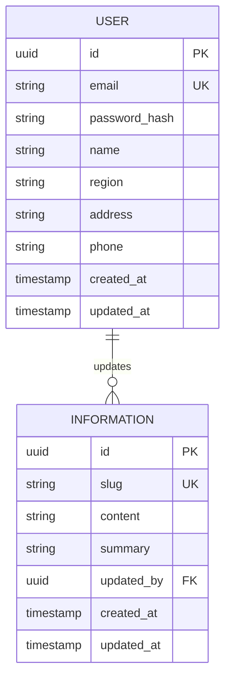

# AI Developer Test

## 1. Instructions

- Clone or fork this repository.
- Create a new branch: `{user}-assignment`.
- Invite **@ikhsan017**, **@dhiaaziz**, and **@tataamal** as collaborators.
- Follow the setup instructions below before running the project.

## 2. About Application
This application is the information management system for **SPEC Toolbox**, built with **Laravel**. It provides:

- **Information management (CRUD)** — create, read, update, and delete the company's knowledge base records.
- **Generative AI** — assist in writing and improving Information content.
- **Chatbot portal** — answer questions about our products.

The knowledge base covers timber structural engineering. Its content can be sourced from our website, the internet, or other references, such as a glossary of timber structural engineering terms.

## 2. Core AI Features (Main Criteria)

Your task is to build AI features on top of this existing system.

- [ ] Connect LLM to Existing System
- [ ] Make Classification Agent
- [ ] Make Content Generative AI

### Connect LLM to Existing System

- Connect at least one LLM provider to this Laravel application through `config/ai.php` and environment variables.
- Put AI logic in dedicated Agent / Service classes, not directly in controllers.
- Handle provider failures properly: errors, timeouts, and rate limits should show a clear message to the user and must not crash the page.
- Document which provider and model you used and how to run the project with it.

### Make Content Generative AI

- Build a **chatbot panel** where the user can talk with the AI and give instructions based on the conversation. Conversation history should be persisted in the database. Streaming responses are a plus.
- The user can **build Information content with AI**: generate the `content` and `summary` fields, and save the result to the `information` table.
- The user can **evaluate or optimize content**, either by chatting ("make it shorter", "adjust for the US market") or with an **Optimize** button. Show the proposed changes (before / after) so the user can accept or reject them before saving.

### Make Classification Agent

- When the user writes or edits content, an agent checks whether the words and phrases make sense against the company's Information database (consistency with existing facts, terminology, and regional context).
- The agent should return **structured output** (for example `word`, `type: sensitive | recommended`, `reason`, `suggestion`) instead of free text.
- Show the classifier result in the editor: **red underline** for sensitive words and **green underline** for recommended words. Hovering a word or clicking it shows the reason and the suggestion.

## 3. AI Production Ready (Additional Criteria)

After building the AI flow, prepare a production-ready architecture. You do **not** need to complete every item. Choose the items you can do well, because depth and correctness count more than the number of ticked boxes. For every item you work on, explain your approach and trade-offs in your submission notes.

**A. AI Quality & Evaluation**
- [ ] **Automated Evaluation Pipelines** — A repeatable eval dataset and automated tests that score agent output (for example classifier accuracy against labeled samples), runnable from the CLI or CI.
- [ ] **Edge Case Coverage** — Defined behavior for empty or very long input, mixed languages, unsupported regions, and prompt-injection attempts.
- [ ] **Deterministic Behavior Control** — Stable and predictable output through structured output schemas, controlled temperature, and versioned prompts.

**B. Infrastructure & Architecture**
- [ ] **Data Ingestion & RAG Layer** — Ingest the `information` records into embeddings / a vector store, and retrieve the relevant context for the chatbot and the classifier.
- [ ] **State & Memory Management** — Conversation memory that is persisted, scoped per user, and bounded (truncation or summarization) so the context does not grow without limit.
- [ ] **Provider Abstraction** — Switch providers or models through config, with fallback when the primary provider fails.

**C. Security, Privacy & Compliance**
- [ ] **Data Access Boundaries** — Agents and tools can only read or write data the current user is authorized to access.
- [ ] **Secret Management** — API keys live only in environment or secret storage and never reach the frontend, logs, or git history.
- [ ] **Organizational Guardrails** — Input and output checks for PII, forbidden topics, and company or brand rules before content is shown or saved.

**D. Monitoring & Observability**
- [ ] **Drift Detection** — Track output quality or distribution over time (for example the classifier's flag rate or eval scores) and surface regressions.
- [ ] **End-to-End Tracing** — Trace each request from user action → agent → tool → provider, including latency, token usage, and errors.

**E. Cost & Scalability**
- [ ] **Token & Compute Budgeting** — Per-user or per-request token limits, with caching and queued jobs for expensive operations.
- [ ] **Load & Stress Testing** — A simple load test of the AI endpoints with documented results and identified bottlenecks.

## 4. Database : "Information" Table

The `INFORMATION` table is the company's knowledge base. It is the source of truth for the classification agent and the RAG layer. `content` and `summary` hold the default version, and the suffixed columns hold the regional variants. `updated_by` references the user who last changed the record.

> Note : `updated_by` is a foreign key to the `USER` table.

## 5. Design Reference
A design reference is available in Figma:

[Figma Design File](https://www.figma.com/design/de4c8FyC0Xrum4E8DQHx7D/AI-Developer-Test?node-id=1-48&t=Z4igGT29R6Kp9AJp-1)

> The design is for reference only. Exact visual matching is not required.

## 6. Evaluation Criteria

| Area | Weight | What we look at |
|---|---|---|
| **Core AI Features** | 45% | All three features work end-to-end; prompt quality and structured output; usable chatbot and highlight UX |
| **AI Production Ready** | 25% | Depth and correctness of the items you chose in section 3, and how clearly you explain the trade-offs |
| **Code Quality & Architecture** | 15% | AI logic in Agent / Service classes; Laravel conventions (Form Requests, Policies, Route Model Binding); clean, maintainable code |
| **Testing** | 10% | Unit and feature tests with the AI provider faked; at least one eval-style test for the classifier |
| **Documentation & Demo** | 5% | Clear setup steps, architecture notes, and a demo that shows every flow |

## 7. Submission
The deadline will be provided via email.
Please ensure submission within the specified timeframe.

Include short submission notes (in your README or a `SOLUTION.md`) that cover the provider and model you used, your architecture, the production-ready items you worked on, and any known limitations.

## 8. Demo
Include one of the following with your submission:

- A demo video (recommended), or
- A live project link

Ensure the demo clearly showcases:

- Chatting with the AI and creating Information content from the conversation
- Evaluating / optimizing content via chat and the Optimize button
- The classification agent highlighting sensitive (red) and recommended (green) words
- A short walkthrough of your architecture and the production-ready items you implemented
